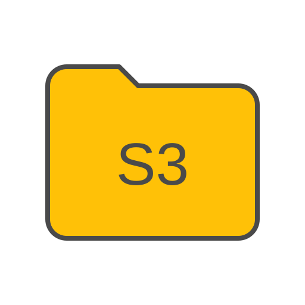
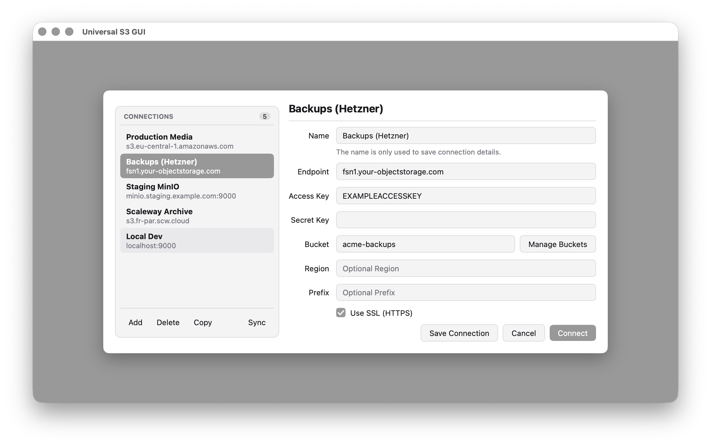
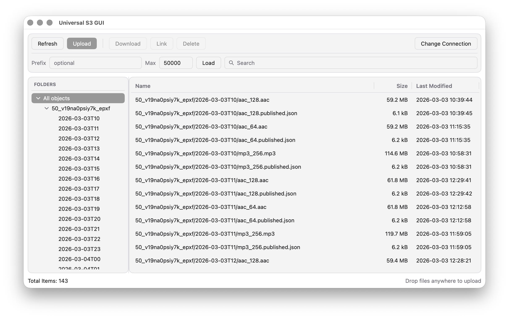
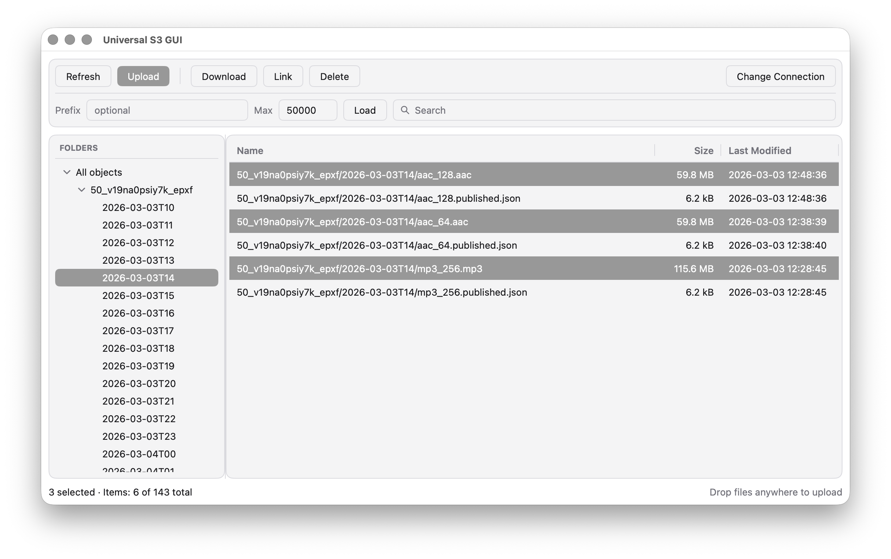
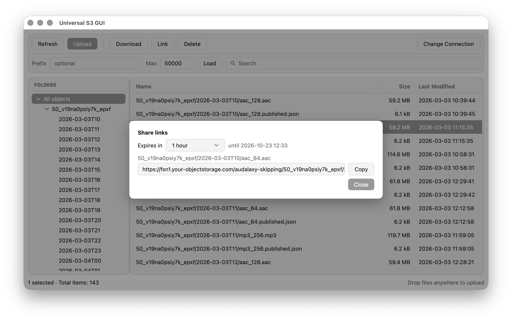
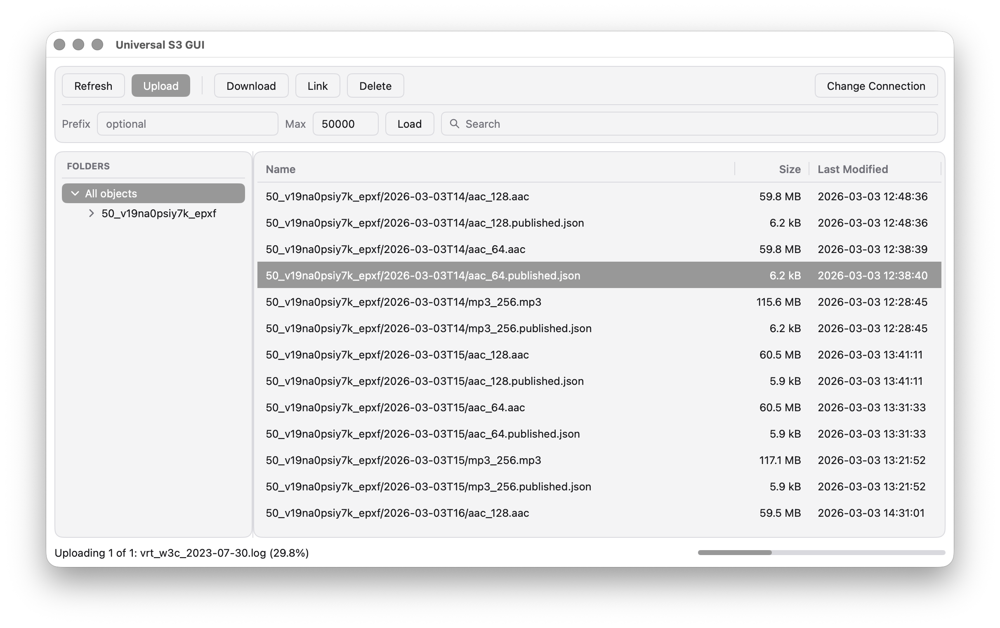

# Universal S3 UI (us3ui) 


Universal S3 UI is a lightweight, cross-platform storage browser. It started as a GUI for S3-compatible object storage (with a particular focus on non-AWS implementations) and now speaks **S3, SFTP and FTP/FTPS** through the same interface: one connection manager, one file list, and sync between any two connections.
Built with Go and [MyGo](https://github.com/egoist/mygo) (native, GPU-drawn UI, no cgo), this application provides a seamless experience across macOS, Windows, and Linux and is provided as a native app.
[https://us3ui.pteich.de](https://us3ui.pteich.de)

## Features

- **Multiple Protocols**:
  - **S3**: any S3-compatible storage service (MinIO, Ceph, AWS, Hetzner, OVH, Scaleway, etc.)
  - **SFTP**: password or private key (with passphrase) login; host keys are trusted on first use and checked on every later connection
  - **FTP/FTPS**: plain FTP or explicit TLS, anonymous login, optional SOCKS5 proxy with authentication
- **Connection Manager**: Save, copy and rename connections of any protocol
- **Secure Credential Storage**: Passwords, secret keys, key passphrases and proxy passwords are kept in your operating system's keychain (macOS Keychain, Windows Credential Manager, Linux Secret Service) instead of plaintext on disk
- **Drag-and-Drop Support**: Drag multiple files from your local machine to upload them
- **Secure Connections**: HTTPS for S3, SSH for SFTP, TLS for FTPS
- **File Management**:
  - Browse files and objects with size information
  - Upload local files (large files go up in parts automatically)
  - Download selected files to your local machine: downloads are verified and published atomically, never overwrite existing files, and keep the objects' folder structure
  - Stop running uploads and downloads from the status bar
  - Delete files and objects
  - Select files and generate temporary download links, valid from 15 minutes up to 7 days (S3 only)
  - Create and remove buckets (S3 only)
  - Refresh the listing
- **Asynchronous Loading**: Load objects without blocking the UI
- **Search Functionality**: Easily find objects with simple fulltext search
- **Progress Tracking**: Visual progress bar for long-running operations
- **Pagination**: Load objects in batches for improved performance
- **Detailed Object Information**: View object name, size, and last modified date
- **Responsive UI**: Sortable, resizable columns for better visibility of object details
- **Sync**: Copy files between any two saved connections (e.g. FTP to S3) without touching local disk
- **Auto-updates**: Installed apps update themselves from signed GitHub releases

## ❤️ Sponsoring

If you find Universal S3 UI helpful, please consider supporting its development through GitHub Sponsors. Your support helps maintain and improve this project!

[](https://github.com/sponsors/pteich)

## Download Pre-built Binaries

You can download pre-built binaries for Linux, macOS, and Windows from the [GitHub Releases](https://github.com/pteich/us3ui/releases) page. This allows you to quickly get started with Universal S3 UI without needing to build from source. Simply download the appropriate binary for your operating system, extract it, and run the executable.

## Running on macOS and Windows (Unsigned builds)

The pre-built binaries are currently not code-signed. macOS Gatekeeper and Windows Defender SmartScreen may warn or block the first launch. This is expected for unsigned apps. You can still run the app by following the steps below.

### macOS

1. Download the macOS ZIP from the Releases page and unzip it.
2. Optional: Move "Universal s3 GUI.app" to your Applications folder.
3. First launch via Finder:
   - Right-click (or Ctrl-click) the app and choose "Open".
   - When the warning dialog appears, click "Open". This is only needed once per download.
4. If you already tried to open it by double-click and it was blocked:
   - Open System Settings → Privacy & Security.
   - In the Security section, find the message that the app was blocked and click "Open Anyway", then confirm with "Open".
5. Advanced (optional): Remove the download quarantine in Terminal if Finder keeps blocking it:
   
```bash
   xattr -dr com.apple.quarantine "/Applications/Universal s3 GUI.app"
```

   Adjust the path if you keep the app outside Applications.

### Windows

1. Download the Windows ZIP, right-click it → Properties → if you see an "Unblock" checkbox on the General tab, check it and click Apply, then extract.
2. Start the app by double-clicking the EXE. If you see "Windows protected your PC":
   - Click "More info".
   - Verify the app name, then click "Run anyway".
3. If Windows still blocks it, right-click the extracted EXE → Properties → check "Unblock" (if present), then Apply and try again.


## Getting Started

### Prerequisites

- Credentials for an S3-compatible storage service, an SFTP server or an FTP server
- For building from source: Go (no C toolchain needed)

### Building from source

```bash
make dev        # development app bundle with live reload
make app        # packaged app for this platform into build/<os>-<arch>/
make build-all  # macOS, Windows and Linux packages from any machine
make test
```

### Configuration

When you start the application, you can use the GUI to manage your connections:

1. Create a new connection, choose its **Type** (S3, SFTP or FTP) and provide:

   For **S3**:

   - **Name**: A unique name for your connection
   - **Endpoint**: Your S3 service endpoint (e.g., "play.min.io")
   - **Access Key**: Your S3 access key
   - **Secret Key**: Your S3 secret key
   - **Bucket Name**: The name of the bucket you want to access
   - **Prefix**: (Optional) A prefix to filter objects in the bucket
   - **Region**: (Optional) The region of your S3 service
   - **SSL**: Toggle for HTTPS connection (recommended for production use)

   For **SFTP**:

   - **Host**: The server with an optional port (default 22)
   - **Username** and **Password**
   - **Key File**: (Optional) A private key that is used instead of the password, plus its **Key Passphrase** if it is encrypted
   - **Start Directory**: (Optional) Defaults to the home directory

   The server's host key is stored on first connect (trust on first use) and verified on every later connection.

   For **FTP**:

   - **Host**: The server with an optional port (default 21)
   - **Username** and **Password**: Leave both empty for anonymous login
   - **Start Directory**: (Optional) Defaults to the login directory
   - **Use TLS (FTPS)**: Upgrades the connection with explicit TLS
   - **SOCKS5 Proxy**: (Optional) `host:port` of a SOCKS5 proxy, with optional **Proxy Username** and **Proxy Password**

2. Save the connection. Connection details are stored in a local configuration file (the location depends on your operating system), while passwords and secret keys are stored separately in your operating system's keychain. To rename a saved connection, change its name and choose "Rename Connection" (or "Save as New" to keep both).

3. You can create and save multiple connections for different services, buckets or servers.

The S3 configuration values can also be preset using CLI flags or environment variables. If provided, these will automatically create a special connection named "<Transient>". The available options are:

- **Endpoint**: `--endpoint` or `ENDPOINT`
- **Access Key**: `--accesskey` or `ACCESS_KEY`
- **Secret Key**: `--secretkey` or `SECRET_KEY`
- **Bucket Name**: `--bucket` or `BUCKET`
- **Prefix**: `--prefix` or `PREFIX`
- **Region**: `--region` or `REGION`
- **SSL**: `--usessl` or `USE_SSL`

### Usage

1. Launch the application
2. Select a saved connection or create a new one
3. Click "Connect" to establish the connection
4. Use the main interface to:
   - View files and objects with detailed information
   - Use the search bar to find specific objects
   - Select one or multiple objects to download or delete files
   - Use upload to add new local files
   - Select files and generate temporary download links (S3)
   - Sync files between two saved connections

## Screenshots

Here's a visual walkthrough of the application:

### Login Screen


_The connection manager where you set up S3, SFTP and FTP connections_

### File List View


_Main interface showing the list of objects in your bucket_

### Select files to download


_Select one or multiple objects (Cmd/Ctrl-click, Shift-click) to download or delete_

### Select files to download


_Create a pre-signed link that expires after a selected time_

### Upload Dialog


_File upload interface for adding new objects to your bucket_

## Technical Details

Built using:

- [MyGo](https://github.com/egoist/mygo) - Native desktop apps in Go: GPU-drawn UI, pure Go (no cgo), signed auto-updates
- [MinIO Go Client](https://github.com/minio/minio-go) - S3-compatible storage client
- [pkg/sftp](https://github.com/pkg/sftp) - SFTP client
- [jlaffaye/ftp](https://github.com/jlaffaye/ftp) - FTP/FTPS client

## Security Note

Ensure you're using an encrypted protocol (S3 over HTTPS, SFTP or FTPS) when connecting to production servers to protect your credentials and data in transit. Plain FTP sends passwords unencrypted.
All credentials are only used on your local machine to create the necessary connection.
Saved connections store passwords, secret keys, key passphrases and proxy passwords in your operating system's secure credential store (macOS Keychain, Windows Credential Manager, or the Linux Secret Service) rather than in the configuration file. If no secure store is available, the app falls back to saving them in the local configuration file. Existing connections with plaintext secrets are migrated to the secure store automatically on first launch.

## License

MIT License
